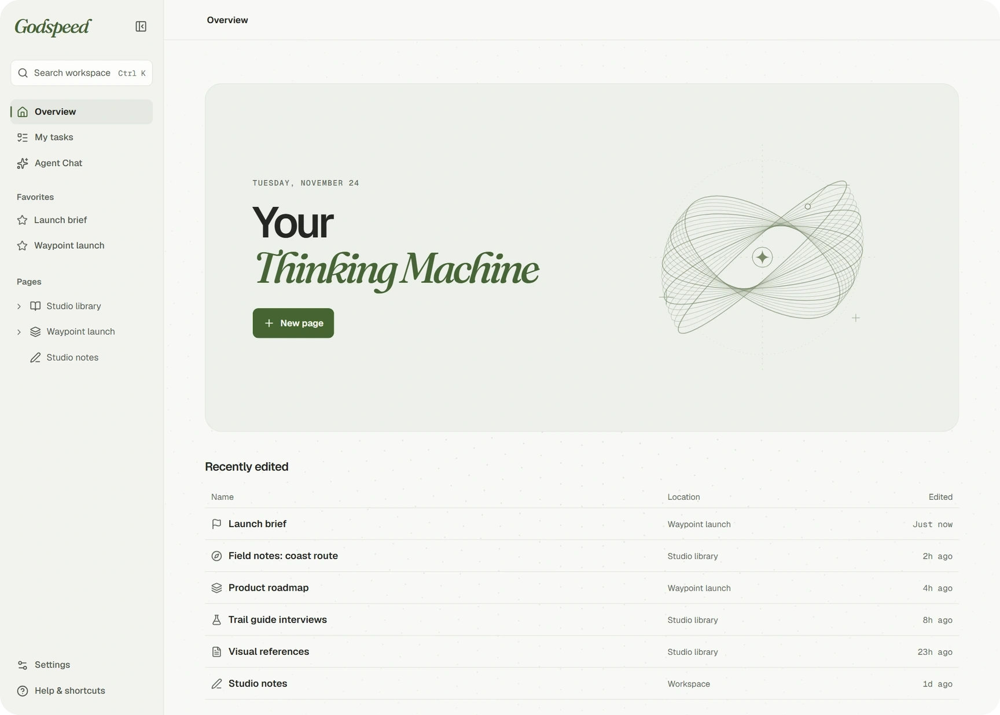
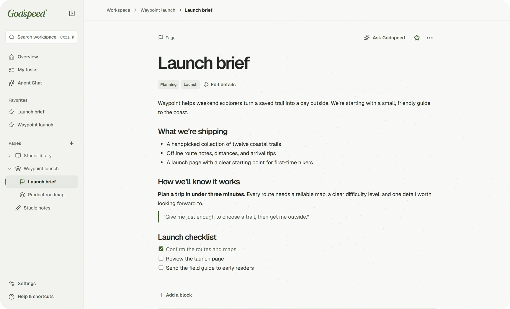
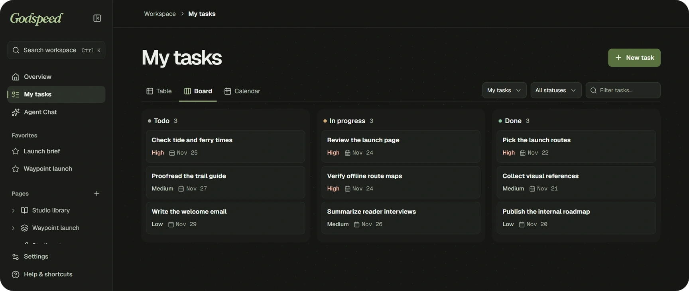
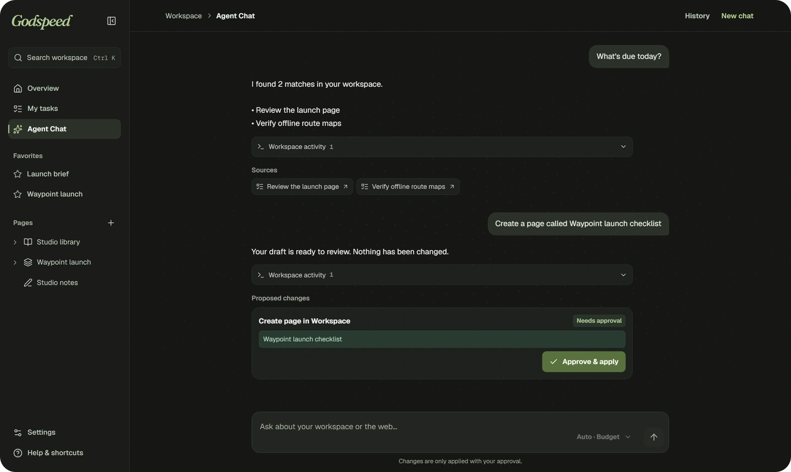

# Godspeed

**A workspace for thinking, planning, and getting things done.**

Write the brief, find the note that sparked it, and turn the next step into a task without leaving your workspace. Godspeed brings together rich-text pages, project planning, and an optional AI agent that works with your notes instead of starting from a blank chat.

[**Run Godspeed locally**](#run-godspeed-locally) · [Read the handbook](docs/handbook.md)



## Give your ideas a place to grow

Start with a line of text. Build it into a brief with headings, checklists, tables, and code. Nest pages inside folders, link related notes, and find what you wrote with **Ctrl/Cmd + K**.



## One task list. Three ways to see it.

Sort priorities in **Table**, move work through **Board**, or see what’s coming in **Calendar**. Each view uses the same tasks, dates, and statuses, so switching views doesn’t mean managing another list.



## Ask a question. Review the change.

Agent Chat can find notes, check what’s due, and draft a page. With a supported model, it can also search the web when it needs current information and show the sources it found. You can inspect its workspace activity, and proposed changes wait for your approval.



*Screenshots show a fictional project in the running app.*

## Local first. AI optional.

Pages, tasks, and chat history are saved in your browser. Once the production app has loaded online, you can keep writing, searching, and managing tasks offline. Export a backup whenever you need one.

No account is needed to use the workspace. For model-powered chat, connect an eligible ChatGPT plan on the local app or configure a separately billed API key. [See the AI setup and data details in the handbook.](docs/handbook.md#ai)

## Run Godspeed locally

Requires Node.js 22+ and npm.

```sh
git clone https://github.com/skrithick/godspeed.git
cd godspeed
npm ci
npm run dev
```

Open **[127.0.0.1:3000](http://127.0.0.1:3000)**. For offline setup, backups, and development checks, see the [Godspeed Handbook](docs/handbook.md).
